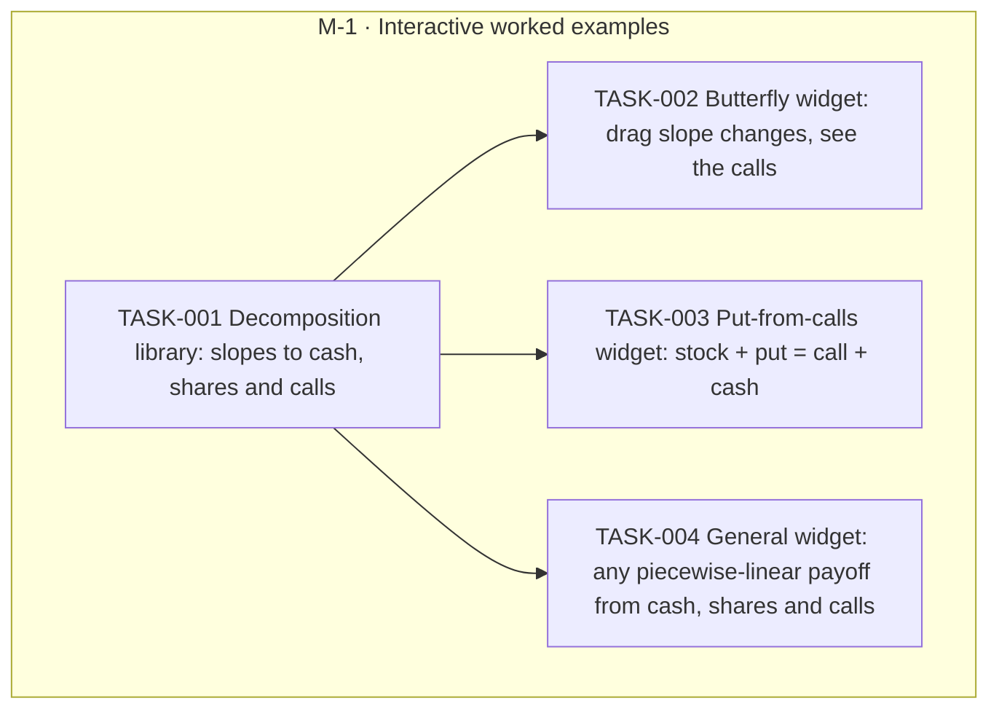

# Interactive worked examples in Chapter 5

Goal `improve-viz` · format `goal/v2`. Live status is derived from GitHub and git and is
never written here: run `goal status improve-viz` or `goal tui`.

Replace the two static worked examples in the 'Any payoff from calls' section of chapter 05-strategies (butterfly; put from calls / put-call parity) with interactive widgets a student can drag and explore.

## Context, scope and non-goals

Today the section 'Any payoff from calls' in `src/content/chapters/05-strategies.mdx` states two examples as prose: the butterfly (slope changes +1, -2, +1 give buy 90 call, sell two 100 calls, buy 110 call) and a put from calls ((K-S)+ = K - S + (S-K)+, i.e. stock + put = call + cash). The existing `StrategyBuilder` shows legs, but not the slope-to-calls reading.

In scope: a tested decomposition function in `src/lib/pricing/`, one widget per example built on `PlotFrame`/`WidgetFrame`, and embedding each in the chapter. Keep the prose and the pointer to Chapter 27.
Out of scope: other chapters, new curriculum entries, changing StrategyBuilder.

Assumption: two separate widgets (not one with a toggle), because the two examples teach different things.

## Risks and open questions

- The two widget PRs both edit the same bullet list in the chapter; the second to merge may need a small rebase.
- Repo rules (CLAUDE.md) apply: colour tokens, `\\$` escaping, 360px width, seeded/reduced-motion, screenshots in both themes.

## Plan structure

<!-- goal:graph:start -->

<!-- goal:graph:end -->

## Worker protocol

For an agent executing exactly one task of this goal:

1. Work only on your task, in your own branch and worktree, branched from `origin/main`.
2. Read `tasks/TASK-NNN.md` (the spec), the outcomes of the tasks it depends on, and the
   accepted decisions it depends on. Never edit specs, other tasks, decisions or `goal.yaml`.
3. After your first commit, open a draft PR into `main` whose body contains the line
   `Goal-Task: improve-viz/TASK-NNN`. Write the body with real newlines.
   Use `gh pr create --body-file FILE` or `gh pr edit --body-file FILE`.
   If the repo has several remotes, resolve `origin` with `git remote get-url origin`.
   For a GitHub origin, use `gh pr create --repo <origin OWNER/NAME> --body-file FILE`.
   Pass the same `--repo <origin OWNER/NAME>` to every other `gh pr` command.
4. Do the work and run the spec's Verify commands.
5. Write `tasks/TASK-NNN.outcome.md` with an `## Acceptance` checklist (each item followed by
   its evidence) and a `## Summary` (what, how, deviations, verified revision, proposed
   follow-ups). Commit it in the same PR.
6. Mark the PR ready for review when checks pass or none are configured.
   Failing or pending checks block delivery. Never merge.
7. Blocked by a missing decision, access or data? Explain it in the outcome, add the line
   `Goal-Blocked: <reason>` to the draft PR body, and stop. For a material decision, also
   write `## Decision request` in the outcome with the question, options and trade-offs,
   and your recommendation under `### Recommendation` (omit it if you have none). Add
   `Goal-Decision: <one-line question>` to the draft PR body, commit and push, then stop
   through exit (B). Refresh or `goal sync` creates a decision in the Inbox. Under
   `decide: experts`, the committee advises. The owner or the copilot
   accepts or rejects it, never a headless orchestrator. After acceptance,
   the Resume task action in `:` resumes the task with the decision in its resume note.
